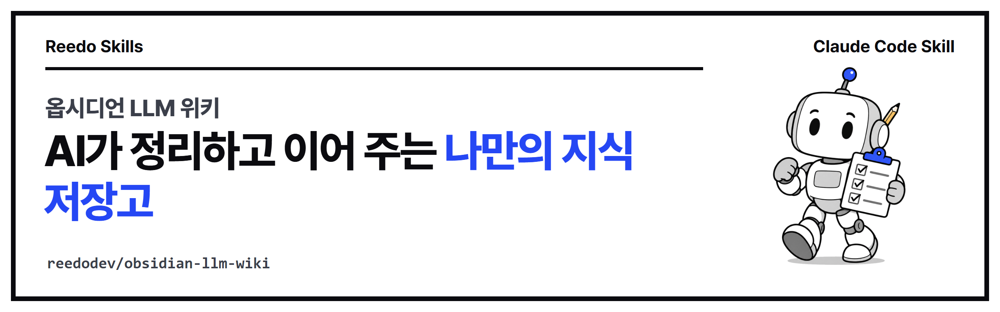

<p align="center"></p>

<p align="center">
<a href="https://github.com/reedodev/obsidian-llm-wiki/actions/workflows/test.yml"></a>


</p>

# 옵시디언 LLM 위키 (obsidian-llm-wiki)

옵시디언 보관함을 Karpathy가 제안한 LLM 위키 방식으로 만듭니다. 받은자료·원본·위키·결과물 폴더와 운영규칙, 서식, 목록을 한 번에 만들고, AI가 자료를 넣고 질문에 답하고 점검하는 순서를 정해 둡니다. 3D 지식그래프와 노트 먼저 찾아보기 스킬이 읽는 바로 그 저장고입니다.

[English guide below](#english)

<!-- beginner-guide -->
## 처음 쓰시는 분을 위한 안내

### 이럴 때 씁니다

- 메모, 기사, 영상 자막이 폴더마다 흩어져 있어서 "그때 정리한 게 어디 있더라" 하고 자주 찾게 됩니다.
- AI에게 같은 설명을 매번 처음부터 해야 해서 번거롭습니다.
- AI가 정리해 준 노트가 어디서 온 내용인지, 믿어도 되는지 알기 어렵습니다.

이 스킬은 빈 폴더 하나를 "AI가 읽고 정리하는 지식 저장고"로 바꿔 줍니다. 폴더 구조, AI가 먼저 읽을 규칙 문서, 노트 서식, 목록 파일을 한 번에 만들고, 나중에 링크가 깨졌는지와 오래된 문서가 없는지 점검해 줍니다.

### 낯선 말 풀이

| 말 | 뜻 |
|---|---|
| Claude Code | 터미널에서 AI에게 일을 시키는 Anthropic의 프로그램입니다. 이 스킬은 그 안에서 씁니다. |
| 스킬 | AI에게 "이 일은 이 순서로 하라"고 알려 주는 설명서 폴더입니다. 설치하면 말로 시킬 수 있습니다. |
| 터미널 | 글자로 명령을 입력하는 창입니다. Windows는 PowerShell, Mac은 터미널 앱입니다. |
| 옵시디언 | 마크다운 노트를 폴더째 열어 서로 연결해 보여 주는 무료 노트 앱입니다. 없어도 이 스킬은 동작합니다. |
| LLM 위키 | 사람이 자료를 고르면 AI가 요약하고 기존 문서에 이어 붙이는 방식으로 키워 가는 노트 모음입니다. |
| 저장고(보관함) | 노트가 들어 있는 폴더 하나를 가리킵니다. |

### 준비 확인

터미널에서 아래를 입력해 버전이 나오는지 확인합니다.

```bash
node -v
git --version
```

- `node -v`에 `v18` 이상이 나와야 합니다. 명령을 찾을 수 없다고 나오면 설치합니다.
  - Windows: `winget install OpenJS.NodeJS.LTS` 후 터미널을 닫았다가 다시 엽니다.
  - Mac: `brew install node`
- `git`은 변경 기록을 남길 때만 필요합니다(권장). Windows는 `winget install Git.Git`, Mac은 `brew install git`으로 설치합니다.
- Claude Code가 아직 없다면 [공식 안내](https://code.claude.com/docs/en/overview)를 따라 설치합니다.

### 따라 하기 3단계

**1단계. 설치합니다.** Claude Code 안에서 아래 두 줄을 입력합니다.

```
/plugin marketplace add reedodev/obsidian-llm-wiki
/plugin install obsidian-llm-wiki@obsidian-llm-wiki
```

**2단계. 에이전트에게 말합니다.** 아래 문장을 그대로 복사해서 붙여 넣으면 됩니다.

1. `옵시디언 LLM 위키를 내 홈 폴더의 MyVault에 만들어 줘. 이름은 "내 지식 저장고"로 하고 변경 기록도 남겨 줘.`
2. `운영규칙.md를 읽고, 이 글을 원본으로 저장한 뒤 위키에 요약해 넣어 줘: (붙여 넣을 글)`
3. `위키를 점검해서 고칠 것을 먼저 보여 줘. 내가 확인하기 전에는 고치지 마.`

**3단계. 결과를 확인합니다.** `MyVault` 폴더에 `00_받은자료`부터 `90_첨부`까지 여섯 폴더와 `운영규칙.md`가 생겼는지 봅니다. 옵시디언이 있다면 "보관함 폴더 열기"로 `MyVault`를 열어 봅니다.

직접 명령으로 해 보고 싶다면 이 저장소를 받은 폴더에서 아래처럼 실행합니다. `~`는 홈 폴더를 뜻합니다. 이 방식이 낯설면 `C:\Users\내이름\MyVault`처럼 전체 경로를 써도 됩니다.

```bash
git clone https://github.com/reedodev/obsidian-llm-wiki.git
cd obsidian-llm-wiki
node skills/obsidian-llm-wiki/scripts/init.mjs ~/MyVault --name "내 지식 저장고" --git
node skills/obsidian-llm-wiki/scripts/check.mjs ~/MyVault
```

### 실제로 실행한 결과

아래는 새로 받은 저장소에서 위 명령을 그대로 실행해 얻은 출력입니다(경로만 줄였습니다).

```
$ node skills/obsidian-llm-wiki/scripts/init.mjs ~/MyVault --name "내 지식 저장고" --git
{
 "vault": "~/MyVault",
 "created": 9,
 "skipped": [],
 "next": "AI에게 운영규칙.md를 읽게 한 뒤 첫 자료를 넣어 보세요."
}

$ node skills/obsidian-llm-wiki/scripts/check.mjs ~/MyVault
위키 문서 0개 점검

문제 없음.
```

`created: 9`는 새로 만든 파일 수이고, 같은 명령을 한 번 더 실행하면 `created: 0`과 함께 건드리지 않은 파일이 `skipped`에 나옵니다. 그래서 기존 보관함에 실행해도 파일이 덮어써지지 않습니다.

위키 문서를 하나 넣고 일부러 문제를 만들면 점검 결과는 이렇게 나옵니다(`[[없는문서]]`라는 깨진 연결과, 다시 확인할 날이 지난 문서를 넣어 보았습니다).

```
$ node skills/obsidian-llm-wiki/scripts/check.mjs ~/MyVault
위키 문서 1개 점검

[목록에 없는 위키 문서] 1개
  - 20_위키\개념\테스트 개념.md

[깨진 연결] 1개
  - 20_위키\개념\테스트 개념.md -> [[없는문서]]

[다시 확인할 날 지남] 1개
  - 20_위키\개념\테스트 개념.md: 2026-10-01

고칠 것이 있습니다. 목록을 먼저 보여 주고 확인받은 뒤 고칩니다.
```

읽는 법: 문제가 없으면 "문제 없음"과 함께 종료 코드 0, 고칠 것이 있으면 항목별 목록과 종료 코드 1입니다. 첫 항목(목록에 없는 문서)은 `node skills/obsidian-llm-wiki/scripts/index.mjs ~/MyVault`로 목록을 다시 만들면 사라지고, 나머지 둘은 문서를 직접 고쳐야 합니다.

### 막힐 때

| 증상 | 원인 | 해결 |
|---|---|---|
| `node` 또는 `git`을 찾을 수 없다고 나옵니다 | 설치가 안 되었거나, 설치 직후 터미널을 다시 열지 않았습니다 | 위 "준비 확인"의 설치 명령을 실행하고 터미널을 닫았다가 다시 엽니다 |
| `usage: node init.mjs <vaultDir> ...` 또는 `usage: node check.mjs <vaultDir> [--json]`가 나오고 멈춥니다 | 저장고 폴더 경로를 빠뜨렸습니다(종료 코드 2) | 명령 끝에 `~/MyVault`처럼 폴더 경로를 적습니다 |
| 점검 결과가 `고칠 것이 있습니다`이고 종료 코드가 1입니다 | 목록에 없는 문서, 깨진 연결, 머리말 문제, 다시 확인할 날이 지난 문서가 있습니다 | 목록은 `index.mjs`로 다시 만들고, 나머지는 보고서를 보고 문서를 고칩니다 |
| `init.mjs`를 다시 실행했더니 `created: 0`입니다 | 이미 있는 파일은 덮어쓰지 않도록 만들어져 있습니다 | 정상입니다. 새로 만들고 싶으면 지우지 말고 다른 폴더에 만듭니다 |

<!-- prereq-adapt -->
## 무엇이 필요한가요?

꼭 필요한 것은 Node 18 이상, 저장고로 쓸 폴더, 그리고 위키를 고칠 AI 하나(Claude Code, Codex 등)입니다. 옵시디언 앱과 git은 권장입니다. 전체 표는 [SKILL.md의 준비물](skills/obsidian-llm-wiki/SKILL.md#준비물-쓰기-전에-있어야-하는-것)에 있습니다.

## 바꿔 쓰기

에이전트에게 다음처럼 말하면 구조와 규칙을 바꿉니다.

- "저장고 이름을 '회사 업무 노트'로 해 줘" → `init.mjs <폴더> --name "회사 업무 노트"`
- "원본 폴더에 '회의록'도 만들어 줘" → `10_원본/회의록/` 추가와 운영규칙 표 한 줄
- "문서 종류에 '레시피'를 추가해 줘" → `운영규칙.md`와 `check.mjs`의 `TYPES`를 함께 수정

말과 바뀌는 곳의 대응표는 [SKILL.md의 바꿔 쓰기](skills/obsidian-llm-wiki/SKILL.md#바꿔-쓰기-이렇게-말하세요)에 있습니다.

## 같이 쓰면 좋은 스킬

- [obsidian-brain-3d](https://github.com/reedodev/obsidian-brain-3d): 이 저장고를 엑스레이 뇌와 세계수 3D로 봅니다.
- [vault-recall](https://github.com/reedodev/vault-recall): 작업 전에 이 저장고에서 관련 교훈을 먼저 찾습니다.
## 설치

**Claude Code 플러그인으로 설치**

```
/plugin marketplace add reedodev/obsidian-llm-wiki
/plugin install obsidian-llm-wiki@obsidian-llm-wiki
```

**폴더만 복사**

```bash
git clone https://github.com/reedodev/obsidian-llm-wiki.git
cp -r obsidian-llm-wiki/skills/obsidian-llm-wiki ~/.claude/skills/
```

필요한 것: Node 18+

## 바로 해 보기

```bash
node skills/obsidian-llm-wiki/scripts/init.mjs ~/MyVault --name "내 지식 저장고" --git
node skills/obsidian-llm-wiki/scripts/check.mjs ~/MyVault
```

자세한 절차, 옵션, 한계는 [SKILL.md](skills/obsidian-llm-wiki/SKILL.md)에 있습니다. 에이전트가 이 파일을 읽고 그대로 따릅니다.

## 시험

`node tests/run.mjs`가 SKILL.md 형식을 검사하고 예시 파일로 스크립트를 실제로 실행합니다. 푸시할 때마다 GitHub Actions가 같은 시험을 돌립니다(위 test 배지).

<!-- credits -->
## 출처와 영감

- **LLM Wiki 아이디어**: Andrej Karpathy가 공개한 [LLM Wiki 아이디어 파일(llm-wiki.md)](https://gist.github.com/karpathy/442a6bf555914893e9891c11519de94f)에서 왔습니다. 사람이 자료를 고르고 AI가 위키를 계속 고쳐 나가며, 옵시디언으로 결과를 본다는 핵심 방식은 이 글의 것입니다.
- 원문은 일부러 구체적인 구조를 정하지 않은 아이디어 문서입니다. 이 스킬의 한국어 폴더 이름(받은자료·원본·위키·결과물), 머리말 항목, 확인 상태 다섯 단계, 운영규칙 문서, 점검·목록 스크립트는 작성자가 실제로 저장고를 운영하며 정한 것이고, 원문의 글이나 코드를 옮기지 않았습니다.
- 더 알고 싶다면 원문을 직접 읽어 보는 것을 권합니다.

## 만든 사람

**리도**, AI 좌충우돌 실습 중인 20년차 엔지니어입니다. 매일 AI에게 일을 맡기다가 막힌 부분을 고쳐 가며 이 스킬을 만들었습니다.
[YouTube @Reedodev](https://www.youtube.com/@Reedodev) · [Threads @reedo.dev](https://www.threads.com/@reedo.dev) · [GitHub @reedodev](https://github.com/reedodev)

같이 만든 다른 스킬: [설명 영상 만들기](https://github.com/reedodev/explainer-studio) · [대본 하나로 만드는 단편](https://github.com/reedodev/scenario-to-film) · [옵시디언 3D 지식그래프](https://github.com/reedodev/obsidian-brain-3d) · [노트 먼저 찾아보기](https://github.com/reedodev/vault-recall) · [작업 기록 강의자료](https://github.com/reedodev/work-to-lecture-deck) · [한국어 말투 점검](https://github.com/reedodev/korean-tone-check) · [네이버 황금키워드](https://github.com/reedodev/naver-golden-keywords) · [한글 양식 채우기](https://github.com/reedodev/hwpx-form-fill) · [TTS 끝소리 고치기](https://github.com/reedodev/tts-tail-fix) · [카드뉴스 렌더](https://github.com/reedodev/html-card-render) · [영상 비율 검사](https://github.com/reedodev/social-video-gate) · [유튜브 게시 점검](https://github.com/reedodev/youtube-publish-checklist)

---

## English

[Korean guide is above](#옵시디언-llm-위키-obsidian-llm-wiki)

### New here? Start with this

**What it solves.** Notes, articles and transcripts end up scattered across folders, and you re-explain the same context to your AI every time. This skill turns an empty folder into a vault your AI reads and maintains: a folder layout, a rules file the AI reads first, note templates and an index, plus scripts that check for broken links and stale pages.

**Glossary.**

| Term | Meaning |
|---|---|
| Claude Code | Anthropic's command-line program for giving an AI tasks. This skill runs inside it. |
| Skill | A folder of instructions that tells the AI how to do one kind of job. Once installed, you can ask for it in plain words. |
| Terminal | The text window where you type commands: PowerShell on Windows, the Terminal app on Mac. |
| Obsidian | A free note app that opens a folder of Markdown files and shows their links. Optional here. |
| LLM Wiki | A set of notes grown by an AI: you choose the sources, the AI summarizes them and merges them into existing pages. |
| Vault | One folder that holds your notes. |

**Check your setup.**

```bash
node -v
git --version
```

`node -v` must print `v18` or higher. If not found: Windows `winget install OpenJS.NodeJS.LTS` (then reopen the terminal), Mac `brew install node`. Git is optional and only used to keep a change history: Windows `winget install Git.Git`, Mac `brew install git`. Install Claude Code from the [official guide](https://code.claude.com/docs/en/overview).

**Three steps.**

1. Install inside Claude Code:
   ```
   /plugin marketplace add reedodev/obsidian-llm-wiki
   /plugin install obsidian-llm-wiki@obsidian-llm-wiki
   ```
2. Copy these prompts to your agent, one at a time:
   - `Set up an Obsidian LLM Wiki in MyVault in my home folder. Name it "My Knowledge Vault" and keep a git history.`
   - `Read the rules file (운영규칙.md), save this text as a source and summarize it into the wiki: (paste text)`
   - `Check the wiki and show me what needs fixing first. Don't change anything until I confirm.`
3. Look at `MyVault`: six folders from `00_받은자료` to `90_첨부` and the rules file `운영규칙.md` should exist. If you use Obsidian, open `MyVault` as a vault.

To run the scripts by hand, from the cloned repository (`~` means your home folder; a full path such as `C:\Users\you\MyVault` works too):

```bash
git clone https://github.com/reedodev/obsidian-llm-wiki.git
cd obsidian-llm-wiki
node skills/obsidian-llm-wiki/scripts/init.mjs ~/MyVault --name "My Knowledge Vault" --git
node skills/obsidian-llm-wiki/scripts/check.mjs ~/MyVault
```

**Real output** (from a fresh clone; the path is shortened). A first run creates 9 files and the check on an empty wiki passes:

```
{
 "vault": "~/MyVault",
 "created": 9,
 "skipped": [],
 "next": "AI에게 운영규칙.md를 읽게 한 뒤 첫 자료를 넣어 보세요."
}
위키 문서 0개 점검

문제 없음.
```

Running `init.mjs` again prints `created: 0` and lists the existing files under `skipped`, so nothing is overwritten. With one deliberately broken page the check reports the problems below (the output text is in Korean) and exits with code 1:

```
[목록에 없는 위키 문서] 1개        (page missing from the index)
[깨진 연결] 1개                    (broken link: [[없는문서]])
[다시 확인할 날 지남] 1개          (recheck date has passed)
```

How to read it: exit code 0 means clean, 1 means something needs fixing. Rebuild the index with `node skills/obsidian-llm-wiki/scripts/index.mjs ~/MyVault` to clear the first item; the other two need edits to the page.

**Troubleshooting.**

| Symptom | Cause | Fix |
|---|---|---|
| `node` or `git` not found | Not installed, or the terminal was not reopened | Run the install command above and reopen the terminal |
| `usage: node init.mjs <vaultDir> ...` or `usage: node check.mjs <vaultDir> [--json]` (exit code 2) | The vault folder argument is missing | Add a folder path such as `~/MyVault` |
| The check ends with exit code 1 | Pages missing from the index, broken links, front-matter problems or overdue rechecks | Rebuild the index with `index.mjs`, then fix the pages listed |
| `created: 0` on a second `init.mjs` run | Existing files are never overwritten | Expected. To start over, use a different folder |

---

Set up an Obsidian vault as a Karpathy-style LLM Wiki: inbox, sources, wiki, outputs, a rules file every AI reads first, templates and an index, plus scripts to rebuild the index and health-check links, front matter and recheck dates.

**Credits.**
- The LLM Wiki pattern comes from Andrej Karpathy's [llm-wiki idea file](https://gist.github.com/karpathy/442a6bf555914893e9891c11519de94f). The Korean folder layout, front-matter fields, status levels, rules file and scripts are this repository's own implementation; no text or code was copied from the gist.

Install: `/plugin marketplace add reedodev/obsidian-llm-wiki` then `/plugin install obsidian-llm-wiki@obsidian-llm-wiki`, or copy `skills/obsidian-llm-wiki` into `~/.claude/skills/`. See [SKILL.md](skills/obsidian-llm-wiki/SKILL.md) for the full procedure. MIT License; third-party models, fonts and libraries keep their own licenses.
